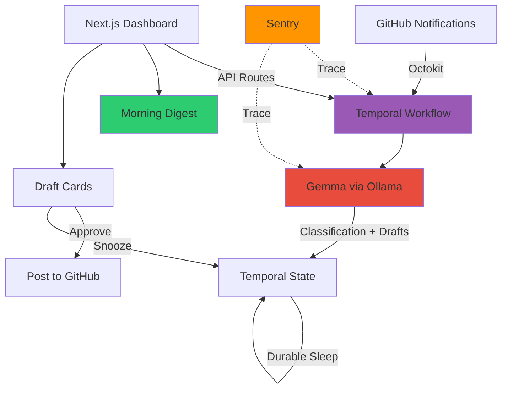

# Snooze Desk 🌙

**The lazy developer's overnight desk** — Process GitHub notifications with local AI while you sleep.

A Hacktoberfest 2026 Open-Source AI Challenge project (Week 3: "Slow and Steady").

[](LICENSE)
[](https://ai.google.dev/gemma)
[](https://temporal.io)
[](https://sentry.io)

## What It Does

Snooze Desk runs a durable Temporal workflow that processes your GitHub notifications overnight using a local Gemma model. Wake up to:

- **A 3-line morning digest** summarizing what needs your attention
- **Smart classification**: needs-you (red), can-wait (gray), or ignore
- **AI-drafted replies** for issues and PRs that need a response
- **One-click actions**: approve, edit, snooze, or reject each draft
- **Durable snoozing**: workflow sleeps for hours or days, survives restarts

Everything runs locally. Your notifications never leave your machine. Zero API costs.

## Why Open-Source AI?

1. **Privacy**: All processing happens on your laptop. No data leaves your machine.
2. **Zero cost**: No API keys, no usage fees. Run it forever for free.
3. **Offline-capable**: Works without internet after initial setup.
4. **Customizable**: Swap models, adjust prompts, fine-tune classification logic.
5. **Transparent**: See exactly how your notifications are classified and what the AI generates.

## Architecture



### How It Works

1. **Overnight Run**: A Temporal workflow fetches your GitHub notifications (review requests, mentions, issues, etc.)
2. **Local Classification**: Each notification is sent to Gemma running locally via Ollama
3. **Smart Drafts**: Gemma classifies urgency and drafts a reply if needed
4. **Morning Digest**: AI generates a 3-line summary of what's waiting
5. **Interactive Dashboard**: Review drafts, approve replies with one click, or snooze items for later
6. **Durable Snoozing**: Snoozed items use Temporal timers — workflow sleeps for hours/days and survives worker restarts
7. **One-Click Posting**: Approved replies are posted to GitHub only when you explicitly click

## Sponsor Technology

### Gemma ($200 Featured Category)

We use **Gemma 4 E4B** (Google's latest open-weight model, released October 2026) for all AI tasks:
- Classification of notifications into `needs-you`, `can-wait`, or `ignore`
- Draft reply generation (2-3 sentences, professional tone)
- Morning digest summary generation

**Model**: `gemma4:e4b` (6.6GB, 128K context, frontier reasoning)

Runs locally via **Ollama** with configurable model selection. Default is Gemma 4 E4B for best reasoning performance. For CPU-only or resource-constrained testing, you can use `gemma3:4b` (3.4GB) or `gemma3:1b` (806MB).

**Why Gemma 4**: Latest generation with enhanced reasoning, coding, and agentic capabilities. Outperforms Gemma 3 on MMLU Pro (69.4% vs 67.6%), coding benchmarks, and agent tasks.

### Temporal ($100 Partner Category)

**Temporal TypeScript SDK** powers the core workflow:
- **Durable execution**: Workflow state survives worker restarts
- **Snooze with timers**: `sleep()` for hours or days without holding resources
- **Signal handling**: Dashboard sends `snoozeSignal` and `approveSignal` to running workflows
- **Workflow-as-code**: All logic is in version control, no external orchestrator config

**Why Essential**: The only way to durably snooze for hours/days without holding a process open. Workflows survive crashes, deployments, and even VM restarts.

### Sentry Agent Tracing ($100 Partner Category)

**Sentry AI Monitoring** instruments the entire agent:
- Every Gemma inference call is traced as an `ai.inference` span
- GitHub API calls are traced as `ai.activity` spans
- Workflow steps show up in distributed traces
- Performance metrics: latency, model used, classification results
- Works without a DSN (tracing just disabled) for easy local dev

**See detailed documentation**: [SENTRY_TRACING.md](SENTRY_TRACING.md)

**What we measured** (measured Oct 22, 2026 on a CPU-only Linux box; real Temporal + Ollama, Sentry accepted 54/54 envelopes):
- gemma4:e4b prompt v2 classify: mean 49195 ms (37485 to 65936), 6/6 labels correct
- gemma4:e4b prompt v1 classify: mean 58123 ms (41556 to 71342), 5/6
- gemma3:1b v1/v2 classify: ~1.7–2.9 s, 3/6 (labels everything `needs-you`)
- Digest: gemma3:1b 1390–1991 ms; gemma4:e4b 53766–56679 ms
- Ollama killed mid-classify: span error, Temporal retry, attempt 2 recovered (trace `7c93349423c940d88d49e00f027c6900`)

Default: classify with `gemma4:e4b` (prompt v2), digest with `gemma3:1b`. Demo mode uses cached drafts and does not wait on Ollama.

## Demo

### Screenshots

*Coming soon: Dashboard digest view, draft cards, snooze action, Temporal UI with timer*

### Video Walkthrough

*Coming soon: End-to-end demo showing workflow start, classification, approval, and posting*

## Setup (macOS)

### Prerequisites

- Node.js 18+
- pnpm (`corepack enable && corepack prepare pnpm@latest --activate`, or `brew install pnpm`)
- [Ollama for Mac](https://ollama.com/download)
- [Temporal CLI](https://docs.temporal.io/cli): `brew install temporal`

### Local run

```bash
# 1. Clone and install
git clone <your-repo-url>
cd snooze-desk
pnpm install

# 2. Start Ollama (skip if the Ollama menu-bar app is already running)
ollama serve

# 3. Pull Gemma 4 E4B (6.6GB; fits a 16GB Apple Silicon Mac)
#    Smaller CPU-only option: ollama pull gemma3:1b
ollama pull gemma4:e4b

# 4. Start Temporal (second terminal)
temporal server start-dev
# UI: http://localhost:8233

# 5. Env
cp .env.example .env
# Leave DEMO_MODE=true for fixtures. Optional Sentry:
# SENTRY_DSN=https://...@sentry.io/...
# NEXT_PUBLIC_SENTRY_DSN=https://...@sentry.io/...

# 6. Dashboard + worker
pnpm dev
# Open http://localhost:43123
```

Demo mode does not need a GitHub token or a running Gemma inference pass. Cached demo drafts are labeled as such; live latency is shown only after a real Ollama call.

To process real notifications: set `DEMO_MODE=false`, add a fine-grained `GITHUB_TOKEN` (`notifications:read`, `issues:write`), keep Ollama running, then `pnpm dev`.

### Environment Variables

```bash
GITHUB_TOKEN=                    # optional in demo mode
OLLAMA_HOST=http://127.0.0.1:11434
OLLAMA_MODEL=gemma4:e4b
TEMPORAL_ADDRESS=localhost:7233
DEMO_MODE=true
NEXT_PUBLIC_DEMO_MODE=true
SENTRY_DSN=                      # optional; tracing off if empty
NEXT_PUBLIC_SENTRY_DSN=          # same DSN for the browser SDK
CLASSIFY_PROMPT=v2               # v1 = original prompt
DIGEST_MODEL=gemma3:1b
```

### Running Without GitHub Token (Demo Mode)

Set `DEMO_MODE=true` to use realistic fixture data:
- 6 sample notifications (bug report, PR review, dependabot, question, praise, spam)
- Mock classifications that demonstrate all three categories
- Full UI flow works without any external services

Perfect for judges to evaluate the project!

## Development

```bash
# Run web + worker concurrently
pnpm dev

# Run web only
pnpm dev:web

# Run worker only
pnpm dev:worker

# Run tests
pnpm test

# Run tests with UI
pnpm test:ui

# Live fixtures through real Ollama (Temporal + worker + models required)
# CLASSIFY_PROMPT=v1 on the worker to A/B the original prompt
OLLAMA_MODEL=gemma4:e4b pnpm live-run
```

## Testing

We include tests for:
- **Classification parsing**: Zod schema validation, retry logic, error handling
- **Workflow logic**: Using Temporal test environment with time skipping for snooze timers
- **API routes**: Mocked Temporal client, success and error cases

```bash
pnpm test
```

## Project Structure

```
snooze-desk/
├── app/                    # Next.js App Router
│   ├── api/                # API routes
│   │   ├── notifications/  # Start workflow
│   │   ├── drafts/         # Fetch drafts
│   │   ├── approve/        # Approve draft
│   │   └── snooze/         # Snooze draft
│   ├── page.tsx            # Main dashboard
│   └── layout.tsx          # Root layout
├── components/
│   ├── features/           # Domain components
│   │   ├── digest-card.tsx
│   │   └── draft-card.tsx
│   └── ui/                 # Generic UI components
├── src/
│   ├── activities/         # Temporal activities
│   │   ├── github.ts       # Octokit integration
│   │   └── gemma.ts        # Ollama integration
│   ├── workflows/          # Temporal workflows
│   │   └── notification-processor.ts
│   ├── lib/                # Utilities
│   │   ├── temporal-client.ts
│   │   └── utils.ts
│   ├── types/              # TypeScript types
│   └── worker.ts           # Temporal worker
├── test/
│   ├── __fixtures__/       # Demo mode data
│   ├── classification.test.ts
│   ├── workflow.test.ts
│   └── api.test.ts
└── README.md
```

## How Each Sponsor Tech Is Used

### Gemma (Featured)
- **What**: Google's open-weight Gemma 4 E4B model (latest generation, October 2026)
- **How**: Runs locally via Ollama for all AI inference
- **Why open**: Privacy-first, zero-cost, works offline, fully customizable
- **Tasks**: Classification (3 categories), draft generation, digest summaries
- **Performance** (measured Oct 22, 2026 on a CPU-only Linux box): gemma4:e4b v2 classify mean 49195 ms; gemma3:1b digest 1390–1991 ms
- **Code**: `src/activities/gemma.ts`

### Temporal (Partner)
- **What**: Durable workflow orchestration
- **How**: TypeScript SDK with local dev server
- **Why essential**: Snooze = sleep for hours/days durably, survives restarts
- **Tasks**: Workflow execution, signal handling, timer-based snoozing
- **Code**: `src/workflows/notification-processor.ts`, `src/worker.ts`

### Sentry (Partner)
- **What**: AI agent tracing and monitoring
- **How**: `@sentry/nextjs` with AI span instrumentation
- **Why useful**: See inference timing, trace errors, measure performance
- **Tasks**: Instrument Gemma inference, GitHub API calls, workflow activities
- **Measurements**: See [SENTRY_TRACING.md](SENTRY_TRACING.md) (measured Oct 22, 2026 on a CPU-only Linux box)
- **Documentation**: See [SENTRY_TRACING.md](SENTRY_TRACING.md) for setup and measured performance
- **Code**: Instrumented in `src/activities/gemma.ts` and `src/activities/github.ts`
- **Note**: Set `SENTRY_DSN` and `NEXT_PUBLIC_SENTRY_DSN`, restart `pnpm dev`. Live traces pending a DSN.

## Demonstrating Workflow Durability

To show Temporal's durability:

1. Start the worker and dashboard: `pnpm dev`
2. Trigger a notification processing run
3. Snooze a draft for 4 hours
4. **Kill the worker** (Ctrl+C)
5. **Restart the worker**: `pnpm dev:worker`
6. The workflow resumes exactly where it left off, timer intact
7. Check the Temporal UI at `http://localhost:8233` to see the timer

This is the "slow and steady" core of Snooze Desk: workflows can sleep for days, and you can deploy new worker code without losing state.

## FAQ

### Why Gemma?
Open-weight and local. Gemma 4 E4B is the default on a 16GB Apple Silicon Mac. CPU-only VMs are slow; use demo mode or a smaller tag like `gemma3:1b` there.

### Why Temporal?
Only way to durably snooze for hours/days without holding a process open. Workflows survive crashes and deploys.

### Why Sentry?
Seeing every model call and tool invocation as spans makes debugging agent behavior trivial.

### Can I use a different model?
Yes! Set `OLLAMA_MODEL` to any Ollama-compatible model. Tested with Gemma variants, but should work with Llama, Mistral, etc.

### Can I deploy this?
Absolutely. Run Temporal Cloud or self-hosted Temporal, deploy the Next.js app anywhere (Vercel, Render, etc.), and point at your Temporal cluster. Just ensure Ollama is reachable.

## License

MIT — see [LICENSE](LICENSE)

## Contributing

This is a Hacktoberfest challenge entry, but contributions are welcome! Please open an issue before major changes.

## Acknowledgments

Built for the DEV Hacktoberfest 2026 Open-Source AI Challenge (Week 3: "Slow and Steady")

**Sponsors**: Google (Gemma), Temporal, Sentry

**Motivation**: Every developer deserves to wake up to a smart, prioritized inbox instead of notification chaos.
